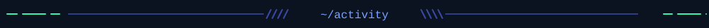
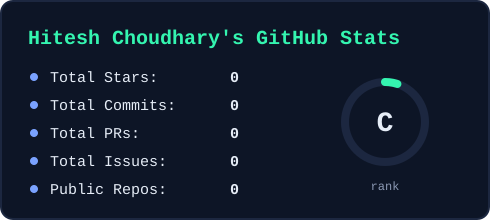
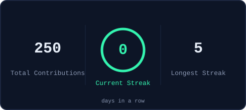
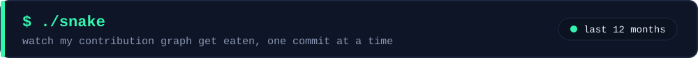
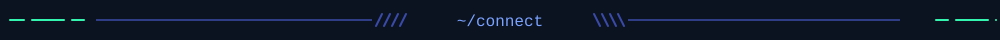

<table>
  <tr>
    <td width="50%" align="center">
      
    </td>
    <td width="50%" align="center">
       
      
    </td>
  </tr>
  <tr>
    <td width="50%" align="center">
      
    </td>
    <td width="50%" align="center">
      
    </td>
  </tr>
</table>

<table>
  <tr>
    <td align="center" width="50%"></td>
    <td align="center" width="50%"></td>
  </tr>
</table>

  &nbsp;
  &nbsp;
  &nbsp;
  &nbsp;
  &nbsp;
  &nbsp;
  &nbsp;
  

<picture>
  <source media="(prefers-color-scheme: dark)" srcset="https://raw.githubusercontent.com/Hitesh754/Hitesh754/output/snake-dark.svg"/>
  
</picture>

<table>
  <tr>
    <td align="center" width="33%">
       
      <b>GitHub</b> @Hitesh754
    </td>
    <td align="center" width="33%">
       
      <b>LinkedIn</b> @hitesh-choudhary-3133a1327
    </td>
    <td align="center" width="33%">
       
      <b>Instagram</b> @Hitesh231466
    </td>
  </tr>
</table>

