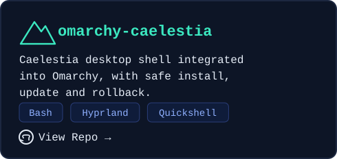
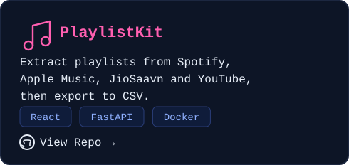
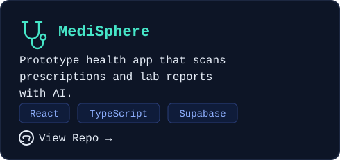
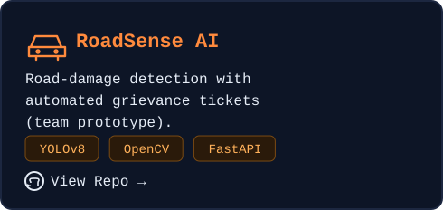

<table>
  <tr>
    <td width="50%" align="center">
      
    </td>
    <td width="50%" align="center">
       
      
    </td>
  </tr>
  <tr>
    <td width="50%" align="center">
      
    </td>
    <td width="50%" align="center">
      
    </td>
  </tr>
</table>

  

  <a href="https://github.com/Hitesh754">github</a> ·
  <a href="https://www.linkedin.com/in/hitesh-choudhary-3133a1327">linkedin</a> ·
  <a href="https://www.instagram.com/Hitesh231466">instagram</a>

